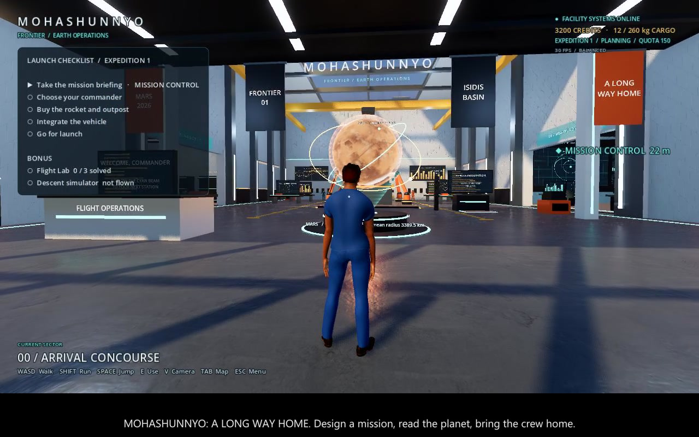

# Mohashunnyo: A Long Way Home

**Design a mission. Read the planet. Bring the crew home.**

A Windows 3D mission-design and Mars-exploration game for the Space Mission Design
Game challenge. Begin with no space knowledge: guided practice teaches movement,
scanning, resource recovery and evidence interpretation. The campaign starts in
an explorable Earth lab and continues through launch, decisions, a flyable landing,
field science, construction and return.

## Play — no technical setup

1. [Download the Windows ZIP](https://github.com/muin99/frontier/releases/download/v0.13.0/Mohashunnyo-Windows.zip).
2. Extract the whole ZIP to a folder.
3. Double-click **Play.cmd**, then choose **PLAY FIRST MISSION** to learn.

Windows 10/11 x64. No Python, Godot editor, API key, account, installer or admin
access is needed. The package includes the engine, assets and NASA data and works
offline. Keep the EXE and PCK together. **Play-Compatible.cmd** offers compatible
graphics; normal startup also retries it after an early graphics failure.

If you downloaded this source repository, **Play.cmd** downloads and verifies the
ready-to-play game once, then reuses it offline. First-time source startup needs
Internet. It does not ask the player to compile or install development tools.

**[Judge's guide](JUDGE_GUIDE.md)** · **[Release and videos](https://github.com/muin99/frontier/releases/tag/v0.13.0)** · **[Validation and known limits](RELEASE_VALIDATION.md)**

## Watch real gameplay

All videos use actual game captures with readable burned-in subtitle narration
and matching SRT files. There is no generated footage or synthetic voice.

| Video | Length | What it shows |
| --- | --- | --- |
| [Game demo](https://github.com/muin99/frontier/releases/download/v0.13.0/Game-Demo.mp4) | 1:26 | Earth lab, crew, launch, landing, exploration, controlled hazard and staged outpost shots |
| [First mission walkthrough](https://github.com/muin99/frontier/releases/download/v0.13.0/First-Mission-Walkthrough.mp4) | 2:49 | Complete live route, both held scans, lessons, return, ascent and debrief |
| [Controls and dashboard](https://github.com/muin99/frontier/releases/download/v0.13.0/Controls-and-Dashboard.mp4) | 1:19 | Objectives, reserve bars, scan cost, landing, thrusters, recovery and return |

[](https://github.com/muin99/frontier/releases/download/v0.13.0/Game-Demo.mp4)

The walkthrough uses scripted controller input with live physics and survival.
The shorter demo is edited and includes disclosed controlled/staged scenarios.
[Subtitle files and footage provenance](docs/media/media-manifest.json) are included.

## The complete mission loop

- **Earth lab:** briefing, commander selection, procurement, vehicle integration,
  optional engineering exercises and landing practice. A checklist marks the next console.
- **Flight:** read the coach, make engineering decisions and learn why the result matters.
- **Landing:** fly manually or use assistance; touchdown quality changes mission outcomes.
- **Mars:** collect evidence, monitor air/power/suit reserves, explore districts,
  build infrastructure and return. Architecture and equipment choices have consequences.
- **Replay:** different seeds, architectures, scientific capabilities and field activities.
  Up to four LAN players can share exploration and construction on the same build.

WASD moves, mouse looks, **hold E** scans, E opens shelter/consoles, F1 explains,
Escape pauses. Space is a restrained Mars hop; Ctrl+Space in the air uses optional
campaign thrusters. Guided practice supplies equipment and protects campaign saves.

## NASA data actually used

**MGS MOLA MEGDR** elevation provides compressed regional terrain and landing
readouts. **Mars 2020 MEDA** temperature, pressure and wind observations inform
historical profiles and mission rehearsal. [Exact products, uses and limitations](docs/DATASETS.md).

NASA measurements are separate from authored local rocks, routes, hazard timing,
resource rates, thrusters and scoring. This is not a live forecast, validated
landing-safety tool or claim of life detection. [Third-party notices](docs/THIRD_PARTY.md).

## Build and verification

Players should use Play.cmd. Developers can double-click **Build.cmd** to fetch the
portable Godot editor and Windows export template automatically, import the
tracked source assets and export the Windows game. No Python is needed for this
build path. The first developer template download is about 1.3 GB; later builds
reuse it. Output: build/windows-v13 and build/Mohashunnyo-Windows.zip.

```powershell
powershell -NoProfile -ExecutionPolicy Bypass -File tools/Verify.ps1
powershell -NoProfile -ExecutionPolicy Bypass -File tools/Test-Release.ps1
powershell -NoProfile -ExecutionPolicy Bypass -File tools/Test-Launcher.ps1
```

The original NASA data preprocessing and video-authoring tools use Python for
maintainers; they are not player dependencies. Video encoding additionally uses
imageio-ffmpeg 0.8.1. The recordings were made with Godot Movie Maker, then edited
with the tracked tools/make_videos.py script.

## Release limits

Testing covers finite routes and seeds, not every PC or possible action. Forward+
lab/recording runs can report resource warnings at shutdown; see the validation
record. New impact/quake hazards are solo-campaign only. LAN requires a local
network and matching builds; Internet matchmaking is not included.

This is an independent educational game, not NASA-endorsed. Disclose pre-event
work, AI assistance and asset sources as required by your organizers. Eligibility
and awards are organizer decisions. Historical iteration details remain in docs/.
